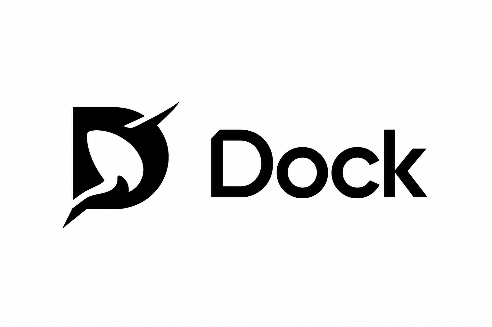
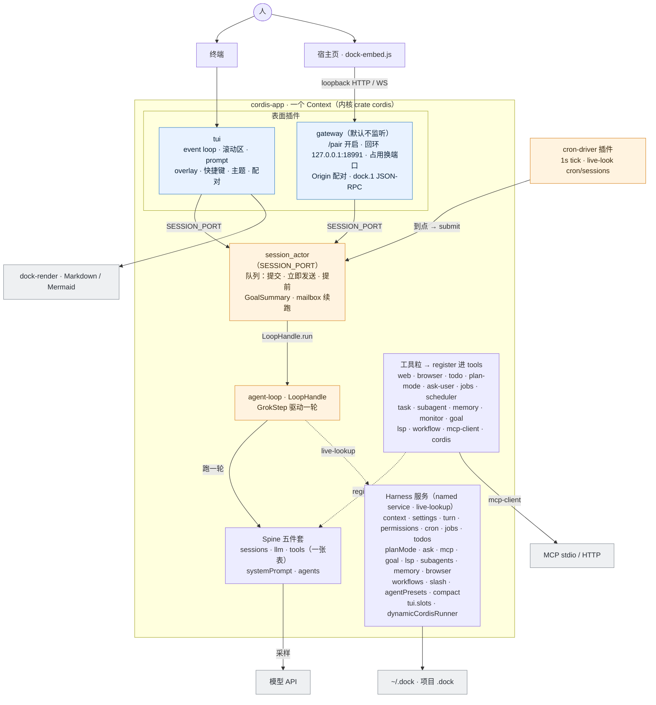
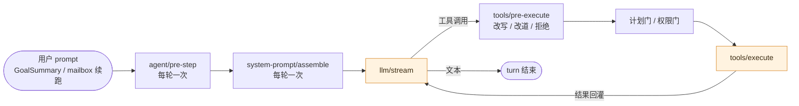

<p align="center">
  
</p>
<h1 align="center">Dock</h1>
<p align="center">
  <b>通用的本地 Agent · 一切皆插件，三端同源</b>
</p>
<p align="center">
  
</p>
<p align="center">
  
  
  
  
  
</p>
<p align="center">
  <a href="#安装">安装</a> •
  <a href="#快速开始">快速开始</a> •
  <a href="#特性">特性</a> •
  <a href="#架构概览">架构</a> •
  <a href="#桌面端">桌面端</a> •
  <a href="#浏览器-companion">浏览器</a> •
  <a href="#仓库">仓库</a> •
  <a href="#文档">文档</a>
</p>

---

## 简介

**Dock 是一个通用的智能 Agent —— 不只写代码。** 研究、写作、自动化、数据分析，或者只是把一件麻烦事办完。

它跑在你自己机器上，用你自己的模型和密钥；但真正让它与众不同的不是「本地」这件事，而是下面三点：

- **通用的** —— 内置的工具面横跨文件、终端、网页、浏览器、本机桌面CUA与画布；MCP 让任何外部服务接进来，技能与工作流让成串的活交给它自己编排。
- **智能的** —— 不是单轮问答。计划模式先想再动，子代理并行分工，目标模式自己认领目标并推进到完成，记忆让它跨会话记住你是谁、做过什么。
- **高度自定义的** —— 没有一处是写死的。模型、人设、工具权限、提示词片段、快捷键、主题、MCP 服务器，全部落在你能读懂、能 diff 的文件里。

Dock 长在一棵 [Cordis](https://github.com/cordiverse/cordis) 插件树上，**没有一个可以私自打补丁的内核**：新能力不是改主干代码，而是挂一颗新插件；插件之间通过 named service 与 waterfall 相遇，你可以在采样前、工具执行前、提示词组装时的任意一环插手。

同一套内核，三个前端：终端里的全屏 TUI、桌面上的 Tauri GUI、以及一行 `<script>` 就能嵌进任意网页的浏览器端。桌面端不是另一套实现，它拉起同一个 Dock 进程，走同一套协议、共享同一份会话历史。

模型端点你自己配（`responses` / `chat_completions` / `messages` 三条协议都支持），密钥走环境变量或 `secrets.json`，会话历史落在 `$DOCK_HOME`。Dock 不做账号、登录与计费。

Cordis 的设计见论文 [_A Programming Paradigm for Spatiotemporal Composability_](https://github.com/cordiverse/paper)。本仓库是 Rust 实现（crate `cordis`），不是上游 JS `cordis/` 的 fork。

---

## 特性

### 🖥️ 终端与桌面，同一个 Dock

- 终端 TUI：全屏、思考可折叠、工具卡片先输入后输出，计划 / 目标 / 子代理各有面板，斜杠命令带补全
- 桌面 GUI（Tauri 2 + React）：侧栏会话树、每一轮改动的文件清单与逐行 diff、子代理独立面板、审查视图、浏览器面板
- 桌面端启动即拉起一个无头 Dock 进程，走 dock.1 协议，ticket 只经 stdout 交接
- 浏览器嵌入：一行 `<script>` 注入 `dock-embed.js`，任意页面变成对话入口；配对走一次性 ticket + 回环
- 三端共享同一份会话历史：终端建的会话，桌面端接着聊，反之亦然

### 🔌 一切皆插件

- 内核不写死任何行为：循环本身也是插件，换采样、换界面、换工具集都不动主干
- 一张 `"tools"` 表：内置工具、MCP 工具、你写的插件工具走同一张表，模型看到的永远是一份统一名册
- 七个扩展点：`agent/pre-step`、`agent/step-start`、`agent/turn-end`、`llm/stream`、`tools/pre-execute`、`tools/execute`、`system-prompt/assemble` —— 采样前改写、工具执行前拦截、提示词按段增删
- 运行时热插：模型可以在对话里用 `cordis_define` / `cordis_run` 现场定义并加载插件，写成 `.dock/plugins` 即永久生效
- 插件能带界面：注册的面板、状态项、工具卡视图在 TUI 和桌面端同时存在

### 🎛 高度自定义

- 模型目录是文件不是菜单：`config.toml` 描述端点、协议、上下文窗口、推理档、单价；密钥走 `env_key` 或 `secrets.json`，不落明文
- 一个端点多条协议：`api_backends` 声明 `responses` / `chat_completions` / `messages`，`/protocol` 现场切换，不必为每条协议重复配一个模型
- Agent 人设是 YAML 目录：`.dock/presets/<id>/agent.yml` 就是一个人格，包含它能用的工具白名单；`agents/<type>.yml` 定义子代理角色
- 提示词可插：贡献插件向 `ContextBook` 登记 `set_base` / `section` / `replace_base`，一段一段拼，而不是替换整个系统提示
- 规约分层：工作区根的 `AGENTS.md`、用户级 `~/.dock/AGENTS.md`、关于你的 `~/.dock/USER.md` —— 追加不覆盖，内容变了才重注
- 快捷键、主题、权限档位、推理强度都能改：`/settings` 里改，或直接改配置
- 记忆引擎可插：跨会话记忆默认关；开了以后按全局 / 工作区分层存储，FTS + 可选向量混合检索

### 🛠️ 工具与 MCP

- 工作区七件套：`list_dir` `read_file` `grep` `search_replace` `bash` `glob` `write_file`
- MCP 一等公民：stdio 与 Streamable HTTP 都接；工具经 `search_tool` / `use_tool` 渐进披露，不占采样工具表
- 内置浏览器 MCP（chromiumoxide CDP，按会话分标签页，22 颗工具）与内置白板 MCP App（Excalidraw，你和 Agent 同画一张图）
- MCP Apps：`io.modelcontextprotocol/ui` —— 服务器可以带自己的界面；服务器还能反过来向用户提问（elicitation），表单与链接模式都走 Dock 的弹窗
- 桌面驾驶：cua-driver 接管本机键鼠，与 `bash` 同级权限门
- 另有：计划模式、提问、后台任务、调度、子代理、目标、记忆、LSP、工作流、代码审查

### 🧠 会话编排

- 子代理：`task` 派活，`send_message` 插话，`interrupt_agent` 打断；对话独立落盘，关掉再回来能接着聊
- 目标：模型自己认领目标并推进，直到 `update_goal(completed)`；可设时长与请求数预算
- 调度：`/loop` 定时提问，任务落盘、跨重启继续跑
- 工作流：Rhai 脚本编排多阶段多代理，内置 `/code-review`（五个角度并行审查）、`/deep-research`
- 多会话同屏：`/dashboard` 并排盯多个会话，peek 面板直接给选中的会话派活
- 插话分叉：`/btw` 开一条只读旁支问一句，答案不进主线上下文

### 🔒 权限与计划门

- 危险动作默认问一句，Shift+Tab 在「询问 / 始终允许」之间切
- 计划是独立模式、不是第三档权限：计划态挡住 bash 与写文件，退出要你批
- 改写也逃不出预设工具集：`tools/pre-execute` 改道后读的是改写后的名字，权限门按新名字判定
- 每一轮的改动都记账：文件清单、逐行 diff、撤销回到该轮改完的样子（该轮之后文件没被再改过才生效）

---

## 架构概览

Dock 的 harness 就是一棵 Cordis 插件树，内核是 crate `cordis`（`Context`、`inject`、named service、waterfall、fiber 生命周期）。`cordis-app` 起**一个** `Context`，分两步长出整棵树：`install_app` 挂 Spine 五件套 + Harness 服务 + 工具粒，`main` 再挂 `system-prompt.base`、`agent-loop`、`session_actor`、`gateway`、`cron-driver`、`tui`。这些同样是插件——`main` 只做组装，不焊行为逻辑。TUI 和 Gateway 都是树上的插件而非旁路进程；宿主页 `embed-sdk` 只连回环 Gateway（`dock.1`），不另起 harness、不直连 TUI。



实线是控制 / 数据流，虚线是「`register` 进 `tools`」与「named service live-lookup」。两个表面都经 `SESSION_PORT` 把 prompt 投给 `session_actor`；`cron-driver` 1s 一 tick，到点用同一个 port 提交。

挂载顺序、完整不变式、磁盘布局见 [docs/ARCHITECTURE.md](docs/ARCHITECTURE.md)。几条最常踩的：工具能力插件 `inject: ["tools"]` 后 `register`，MCP 也进同一张表；named service 在调用点 live-lookup，不要把 `Arc` 关进长生命周期闭包；计划是独立模式，不是第三种权限。

约定、工具名单、斜杠分别见 [AGENTS.md](AGENTS.md)、[TOOLS.md](TOOLS.md)、[CLI.md](CLI.md)。

### 一轮怎么跑

TUI 从不持有循环：按键变成 `SessionCommand` 交给 `session_actor` 管队列，actor 每次取一条调 `agent-loop` 的 `LoopHandle`。默认 driver `GrokStep` 跑一轮采样，安全上限 256 步；换 driver 只换 `agent-loop` 这颗插件，不动 actor。每一环都是 waterfall——监听必须把控制权交给下一环，不要悄悄吞掉链。



`llm/stream` 是枢纽：出工具调用就先过 `tools/pre-execute`（改写参数 / 改道 / 拒绝），再走计划门与权限门，工具体跑完经 `tools/execute` 回采样；出文本才结束。`agent/pre-step` 与 `system-prompt/assemble` 每轮各一次，不随工具轮次重跑。

`system-prompt/assemble` 的载荷是 `PromptAssembly`。贡献插件 `inject: ["context"]` 后向 `ContextBook` 登记 `set_base` / `section` / `replace_base`（对标 `"tools".register`，fiber dispose 注销）。`systemPrompt` 只做 facade：live-lookup `"context"` 求值，再跑 waterfall 供拦截。基座（`system-prompt.base`）只写身份与工作底线，不列工具名；persona 来自 `agent-presets`（写路径用 `.dock/presets`，不用绝对 `{cwd}`）；技能 / 工作流目录与子代理名册来自 `skills` / `tool-workflow` / `tool-task`，走历史 `<system-reminder>`（同样用 `skills/`、`.dock/skills/`、`~/.dock/skills/` 这类通用路径）。计划 / 目标走历史尾部 `<system-reminder>`，不进系统提示。Cordis 写法在技能 `cordis-plugin-development`，不进系统提示。`/context` 与顶栏 live-lookup `ContextBook.window()`，系统提示按段看 token。加/改一段提示词就是在贡献插件里登记，不动 assembler。

---

## 安装

macOS（Apple Silicon）与 Linux（x86_64 / aarch64）有预编译二进制，不需要 Rust 工具链（Intel Mac 请自行从源码构建）：

```bash
curl -fsSL https://raw.githubusercontent.com/P0lar1ght/dock/main/install.sh | sh
```

脚本从 [GitHub Release](https://github.com/P0lar1ght/dock/releases) 取对应平台的
`dock-<target>.tar.gz`，校验 sha256 后装进 `~/.local/bin`（不写系统目录、不需要 sudo）。

| 变量 | 作用 |
|---|---|
| `DOCK_VERSION` | 指定版本，如 `v0.1.0`；默认 latest |
| `DOCK_INSTALL_DIR` | 安装目录，默认 `~/.local/bin` |

变量要写在 `sh` 前面，写在 `curl` 前面只会传给 `curl`、脚本收不到：

```bash
curl -fsSL https://raw.githubusercontent.com/P0lar1ght/dock/main/install.sh | DOCK_VERSION=v0.1.0 sh
```

装完脚本会跑一次 `dock --version` 自检，跑不起来直接报错退出；随后默认执行 `dock init`
（幂等，不覆盖已有 `config.toml`；可用 `DOCK_SKIP_INIT=1` 跳过）。TTY 下分「下载 /
安装 / 初始化」三阶段进度，管道非 TTY 降级为朴素输出。macOS 产物未做代码签名 / 公证，
首次运行若被 Gatekeeper 拦下，按脚本提示执行一次
`xattr -d com.apple.quarantine "$(command -v dock)"` 即可。

装好后建议：

```bash
dock doctor          # PATH / 配置 / 模型目录 / quarantine·glibc
dock upgrade --check # 是否有新版本（不安装）
# dock upgrade       # 原子升级；有进行中会话需 --force
```

Linux 产物动态链系统库，要求 **glibc ≥ 2.39** 与 **OpenSSL 3**（约等于 Ubuntu 24.04+ /
Debian 13+ / Fedora 40+）；更老的发行版与 Windows 暂无可用产物，请见下方「快速开始」从源码构建。

---

## 快速开始

需要 **Rust 1.94+**（版本下限说明见 [docs/DEVELOPMENT.md](docs/DEVELOPMENT.md)）和本机 API key，或在配置里写好端点。

```bash
# 从源码
cargo run -p cordis-app
cargo run -p cordis-app -- --resume          # 恢复本 cwd 最近一次会话
cargo run -p cordis-app -- --resume <id>     # 恢复指定会话

# 已安装的二进制
dock
dock --resume
```

首次启动会全屏接管终端。浏览器 companion 在 TUI 里 `/pair` → Enter 开启回环网关后再打开宿主页。模型目录读 `~/.dock/config.toml`，再读项目 `.dock/config.toml`（后者覆盖）。样例：[`config.toml.example`](config.toml.example)。

最小配置长这样——密钥从环境变量取，不写进文件：

```toml
[models]
default = "my-model"

[model."my-model"]
name = "我的模型"
api_base_url = "https://<your-endpoint>/v1"
api_backends = ["responses", "chat_completions"]
api_model = "<上游真实模型名>"
env_key = "MY_API_KEY"
context_window = 200000
```

| 变量 | 作用 |
|---|---|
| `DOCK_HOME` | 用户配置目录，默认 `~/.dock`（含 `sessions/<cwd>/` 对话 jsonl） |
| `DOCK_MODEL` | 覆盖 `[models].default` |
| `DOCK_API_KEY` / `DOCK_API_BASE` | 覆盖当前模型的 key / base URL |
| `DOCK_GATEWAY_BIND` | 回环网关首选地址，默认 `127.0.0.1:18991`；`/pair` 开启时占用则换下一个端口 |

没有可用模型时 spine 会 echo。不要把 `.dock/config.toml`、API key、`.env` 提交进仓库。

测试：

```bash
cargo test -p cordis-spine -p cordis-tui -p cordis-app -p cordis-gateway -p dock-memory
cargo test -p cordis-spine --test round -- install_app_registers
```

核对工具表是否还对，跑上面这条 `install_app_registers`。

---

## 桌面端

`dock-gui/` 是 Dock 的 Tauri 2 + React 桌面端，与内核同仓库、独立工程。它启动时拉起一个无头 `dock serve`，ticket 经 stdout 交给 Tauri，前端经回环 WebSocket 走 dock.1 —— 一个 Dock 进程，跨目录列会话，每个会话用自己的 cwd。

需要本机 **Rust 1.94+**、**Node ≥ 20.19**（Vite 8 的下限）与 Tauri 的系统依赖。先在仓库根构建二进制：

```bash
cargo build -p cordis-app

cd dock-gui
npm install
npm run tauri dev      # 起窗口
npm run build          # tsc + vite
```

开发构建默认用 `../target/debug/dock`，可用 `DOCK_BIN` 指定别的可执行文件、`DOCK_GUI_CWD` 指定启动目录。

界面能力：侧栏会话树（跨项目）、子代理独立页与逐条对话、每轮改动卡（文件清单 + 逐行 diff + 撤销）、审查面板（工作区 git diff 或单轮改动，批注落行）、浏览器面板（页面渲染 + 截图）、白板（MCP App）、预设编辑器、模型与密钥设置、排程页。设计稿在 `dock-gui/wonder-ui/`（只读），进度在 `dock-gui/docs/PROGRESS.md`。

> 桌面端目前**从源码构建**，发布产物暂不含 GUI 二进制。

---

## 浏览器 companion

同一进程里的 `gateway` 插件只绑 loopback，**默认不监听**。在 TUI `/pair` 里开启后再打开宿主页。首选端口占用时自动换下一个（overlay 显示实际地址）。

构建 `embed-sdk/` 需要 Node >= 18（`embed-sdk/package.json` 的 `engines.node`）。

```bash
cd embed-sdk
npm ci
npm run build
```

打开 [`embed-sdk/examples/inject/index.html`](embed-sdk/examples/inject/index.html)，在 TUI 里 `/pair`（或首次连接弹出的 overlay）批准该 Origin。

```html
<script
  src="/vendor/dock/dock-embed.js"
  data-dock-auto
  data-application="example-app"
  data-gateway-url="http://127.0.0.1:18991"
  data-skin="dudu">
</script>
```

协议与属性见 [`embed-sdk/README.md`](embed-sdk/README.md)。TUI overlay 类命令（`/cd` `/settings` `/pair` …）会回「请在 Dock 终端使用」。

---

## 仓库

第一方 crate 多为 `cordis-*`；`dock-memory`、`dock-core`、`dock-gui` 与二进制 `dock` 用产品名。其余是入口、注入与冻结副本。

```
dock/
├── cordis-rust/          # 插件内核 crate `cordis`：Context、inject、named services
├── cordis-base/          # spine 底座：wire 类型、config.toml、纯引擎（不含插件）
├── cordis-spine/         # Agent 循环、工具、MCP、会话、预设
├── cordis-tui/           # 全屏终端 UI
├── cordis-gateway/       # 回环 HTTP/WS：配对与 dock.1 投影
├── cordis-app/           # 二进制入口
├── cordis-browser/       # 内置浏览器 MCP 服务（chromiumoxide CDP）
├── cordis-apps/          # 内置 MCP Apps 服务（白板：Excalidraw）
├── dock-memory/          # 跨会话记忆引擎（默认关）
├── dock-render/          # Markdown / Mermaid（crate 名暂仍 cordis-markdown / xai-grok-mermaid）
├── dock-core/            # dock.1 协议核心（TS）：类型化线程事件 + reducer，无 DOM
├── dock-gui/             # 桌面 GUI（Tauri 2 + React）
├── embed-sdk/            # 宿主页 JS 注入（dock-embed.js）
├── examples/             # 插件示例：activity / trajectory
├── vendor/               # 冻结副本（mermaid 栈在 dock-render/third_party/）
├── skills/               # Agent skills（内置，Bundled scope）
├── .agents/skills/       # 仓库流程 skills（Agents scope）
├── docs/                 # 架构与开发细节
├── assets/               # 品牌图
├── CHANGELOG.md          # 用户可见变更
├── LICENSE               # Apache-2.0（第一方 crate）
├── NOTICE                # 版权归属 + vendor/ 第三方授权清单
└── config.toml.example   # 用户 / 项目模型目录样例
```

---

## 文档

| 文档 | 说明 |
|---|---|
| [AGENTS.md](AGENTS.md) | 根政策：命令、边界、提交约定；给写代码的 agent / 人（`CLAUDE.md` 指向它） |
| [docs/ARCHITECTURE.md](docs/ARCHITECTURE.md) | 插件树目录地图、不变式、磁盘布局 |
| [docs/DEVELOPMENT.md](docs/DEVELOPMENT.md) | 环境、命令、测试、调试、落点 |
| [docs/REMOTE.md](docs/REMOTE.md) | 远程访问：设备令牌、反向代理 |
| [docs/PLUGIN-VIEWS.md](docs/PLUGIN-VIEWS.md) | 插件视图树：跨端渲染协议 |
| [TOOLS.md](TOOLS.md) | 模型工具索引、插件粒、缺口、明确不做（单颗细节在 [docs/tools/](docs/tools/)）|
| [CLI.md](CLI.md) | 斜杠、快捷键、overlay、底栏 |
| [CONTRIBUTING.md](CONTRIBUTING.md) | 人类贡献流程 |
| [SECURITY.md](SECURITY.md) | 漏洞上报与安全边界 |
| [CHANGELOG.md](CHANGELOG.md) | 用户可见变更（Keep a Changelog 格式） |
| [embed-sdk/README.md](embed-sdk/README.md) | 浏览器 SDK 属性、事件、配对 |
| [dock-gui/README.md](dock-gui/README.md) | 桌面端结构与开发 |
| [cordis-spine/src/tools/skills/builtin/cordis-plugin-development/SKILL.md](cordis-spine/src/tools/skills/builtin/cordis-plugin-development/SKILL.md) | 动态 Cordis 插件工作流（内置技能，references/ 按需读） |
| [.agents/skills/](.agents/skills/) | 仓库流程 skills：git-commit、create-pr |

Crate README 管该包的 API。产品面的权威清单：`TOOLS.md`（模型工具）、`CLI.md`（斜杠 / 快捷键 / overlay）；插件树与不变式见 [docs/ARCHITECTURE.md](docs/ARCHITECTURE.md)。

---

## 致谢与溯源

Dock 的实现过程中参考了这些开源项目：

- [xai-org/grok-build](https://github.com/xai-org/grok-build)（Apache-2.0）—— 终端 Agent 的工具实现、采样协议与渲染栈有大量参考与拷贝
- [deepseek-ai/deepseek-harness](https://github.com/deepseek-ai/deepseek-harness)（MIT）—— 「一切皆插件」的插件模型与 host API 契约
- [cordiverse/cordis](https://github.com/cordiverse/cordis)（MIT）—— 插件树的整体设计，见论文 [_A Programming Paradigm for Spatiotemporal Composability_](https://github.com/cordiverse/paper)

第三方拷贝清单见 [NOTICE](NOTICE)，冻结副本规则见 [vendor/README.md](vendor/README.md)。

工作只在这棵树里：不改、不 path-dep 外部的 `grok-build/`、`deepseek-harness/`、上游 `cordis/`；要源码就复制进 `vendor/xai/` 或对应 crate。

---

## Star History

[](https://star-history.com/#P0lar1ght/dock&Date)
